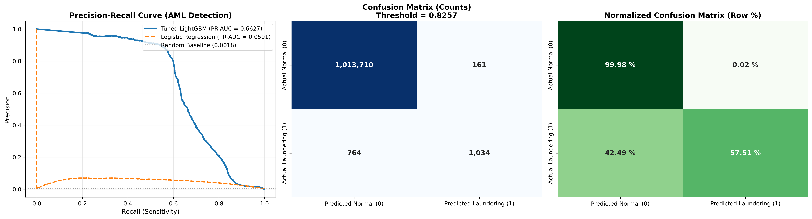

# AML Transaction Monitoring & Regional Risk (MRR) Analytics Platform

An end-to-end **Anti-Money Laundering (AML/CTF)** and **Operational Risk KRI Monitoring** system designed for banking compliance, regional risk management (MRR), and Suspicious Transaction Report (STR / LTKM) investigation workflows.

---

## Project Overview & Architecture
Evaluating **5.07M+ inter-bank and intra-bank transactions** from the IBM AML (`HI-Small`) benchmark dataset, this project bridges deterministic regulatory compliance rules (APU-PPT) with graph-based behavioral machine learning:

1. **CDD Entity Integration & Graph Feature Engineering (`01_eda_cdd_data_prep.ipynb`):**
   * Enriched raw transaction logs with Customer Due Diligence (CDD) entity profiles.
   * Engineered **26 behavioral and network graph features**, including **Fan-In Degree** (unique senders per collector account), **Fan-Out Degree** (unique receivers per distributor account), **Pass-Through Velocity**, **Structuring Zone ($8k–$10k)** flags, and cross-currency/after-hours indicators.
2. **Two-Layer Hybrid Risk Engine (`02_aml_rules_and_ml_model.ipynb`):**
   * **Layer 1 (Deterministic Compliance Rules):** Flags regulatory red-flag patterns (*Smurfing/Structuring*, *High-Velocity Bursts*, *Fan-In Collectors*, *Same-Entity Layering*).
   * **Layer 2 (Optuna-Tuned LightGBM Classifier):** Trained using an **out-of-time split** (80% train / 20% future test set of 1,015,669 transactions) and tuned via **Optuna** to maximize **PR-AUC** under extreme class imbalance (~0.18% illicit rate).
3. **Interactive MRR & STR Investigation Dashboard (`app/streamlit_app.py`):**
   * **Unit-Level KRI Monitoring:** Classifies banking units into **Green / Amber / Red** audit tiers based on red-alert incidence rates.
   * **Network Typology & Alert Triage:** Visualizes Fan-In vs. Fan-Out laundering clusters and provides downloadable STR/LTKM investigation workpapers.

---

## Out-of-Time Model Performance (1,015,669 Test Transactions)

| Model | Optimal Threshold | Accuracy | Precision (Fraud) | Recall | F1-Score | PR-AUC | ROC-AUC | MCC |
| :--- | :---: | :---: | :---: | :---: | :---: | :---: | :---: | :---: |
| **Logistic Regression (Baseline)** | 0.9425 | 98.93% | 6.82% | 39.77% | 0.1164 | 0.0501 | 0.9687 | 0.1613 |
| **Tuned LightGBM + Graph Features** | **0.8257** | **99.91%** | **86.53%** | **57.51%** | **0.6909** | **0.6627** | **0.9801** | **0.7050** |



---

## 🚀 How to Run Locally
```bash
pip install -r requirements.txt
streamlit run app/streamlit_app.py